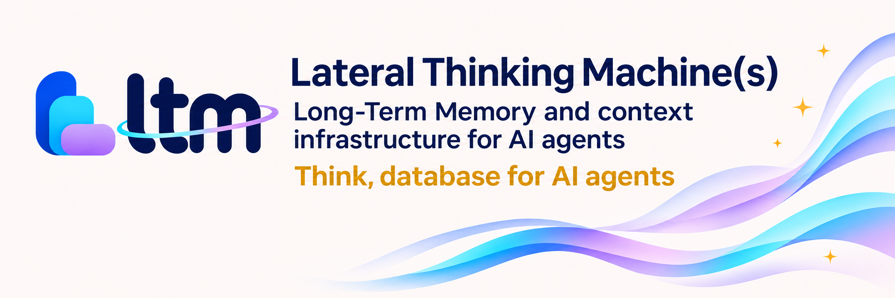

  

<h1 align="center">Memory for what comes next.</h1>

  We're building long-term memory and context infrastructure for AI agents. 
  So useful knowledge can carry forward across conversations, tasks, and time.

## What we're building

<table>
  <tr>
    <td width="50%" valign="top">
      <picture>
        <source media="(prefers-color-scheme: dark)" srcset="https://raw.githubusercontent.com/LateralThinkingMachine/.github/main/profile/assets/atoposdb-dark.svg">
        
      </picture>
      <h3>AtoposDB</h3>
      
<strong>The memory infrastructure.</strong>

      
Our work on the database foundation for long-term memory and connected context.

    </td>
    <td width="50%" valign="top">
      <picture>
        <source media="(prefers-color-scheme: dark)" srcset="https://raw.githubusercontent.com/LateralThinkingMachine/.github/main/profile/assets/enny-dark.svg">
        
      </picture>
      <h3>Enny</h3>
      
<strong>The memory companion.</strong>

      
Our work on bringing long-term memory into everyday interactions.

    </td>
  </tr>
</table>

## Follow our progress

We're building Lateral Thinking Machines around a simple idea: context should grow with the work.

[Explore our public repositories →](https://github.com/orgs/LateralThinkingMachine/repositories)
