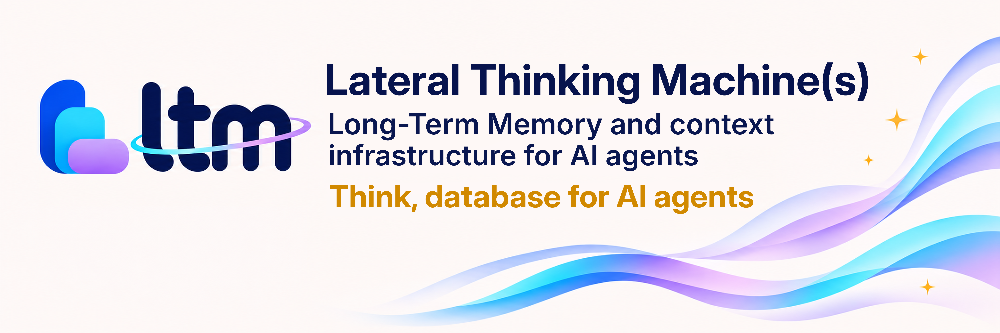
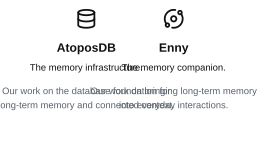

  

<h1 align="center">Memory for what comes next.</h1>

  We're building long-term memory and context infrastructure for AI agents. 
  So useful knowledge can carry forward across conversations, tasks, and time.

## What we're building

   
  <picture>
    <source media="(prefers-color-scheme: dark)" srcset="https://raw.githubusercontent.com/LateralThinkingMachine/.github/main/profile/assets/products-dark.svg">
    
  </picture>

## Follow our progress

We're building Lateral Thinking Machines around a simple idea: context should grow with the work.

[Explore our public repositories →](https://github.com/orgs/LateralThinkingMachine/repositories)
